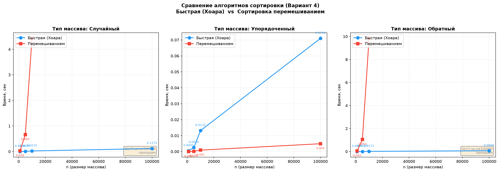

# Лабораторная работа №2
## Алгоритмы сортировки

| | |
|---|---|
| **Кафедра** | ИУ10 «Защита информации» |
| **Вариант** | 4 |
| **Алгоритмы** | Быстрая (Хоара), Сортировка перемешиванием |
| **Студент** | Темирезов Р.Б. |
| **Группа** | ИУ10-38 |
| **Дата выполнения** | 05.10.2026 |

---

## 1. Цель и задачи работы

**Цель:** изучить основные алгоритмы сортировки, провести их теоретический анализ и эмпирически сравнить производительность на массивах различного размера и типа начальной упорядоченности.

**Задачи:**
1. Провести классификацию алгоритмов сортировки по ключевым критериям (устойчивость, место хранения, адаптивность, сложность).
2. Подготовить теоретическое описание, псевдокод и блок-схемы (в TikZ) для алгоритмов варианта 4: Быстрая сортировка (схема Хоара) и Сортировка перемешиванием (шейкерная).
3. Описать достоинства и недостатки каждого алгоритма.
4. Реализовать оба алгоритма на языке Python.
5. Провести ручную трассировку и автоматическое тестирование корректности реализации.
6. Провести сравнительные замеры времени выполнения на массивах размером $n_1 = 1000$, $n_2 = 5000$, $n_3 = 10000$, $n_4 = 100000$ элементов трёх типов: упорядоченного, обратно упорядоченного и неупорядоченного.
7. Построить диаграммы зависимостей времени сортировки от размера массива и сопоставить эмпирические результаты с теоретической сложностью (Big-O).

---

## 2. Словесная постановка задачи

### 2.1. Суть задачи
Исследуется зависимость машинного времени выполнения двух алгоритмов сортировки от размерности входных данных и их начального порядка. Для каждого размера $n$ генерируются три типа массивов целых чисел: случайный (неупорядоченный), упорядоченный по возрастанию и упорядоченный по убыванию. Для каждого массива замеряется время работы обоих алгоритмов, после чего строятся эмпирические кривые $T(n)$ и сравниваются с теоретическими оценками $O(n \log n)$ и $O(n^2)$.

### 2.2. Анализ переменных
- $n$ — размерность входного массива (целое положительное число);
- $A = [a_1, a_2, \dots, a_n]$ — входной массив целых чисел, $a_i \in [1, 10^6]$;
- $T(n)$ — машинное время выполнения алгоритма сортировки при размере входа $n$;
- $C(n)$ — количество сравнений ключей;
- $M(n)$ — количество перемещений (обменов) элементов.

### 2.3. Ограничения и условия эксперимента
1. Все замеры проводятся в одинаковых условиях (одна ОС, одно железо, минимизация фоновых процессов).
2. Для сглаживания случайных флуктуаций (планировщик ОС, сборщик мусора Python, кэширование CPU) результаты усредняются по нескольким запускам.
3. Генерация входных данных вынесена за пределы замеряемого участка кода.
4. Оба алгоритма получают **идентичные копии** одного и того же исходного массива, что гарантирует корректность сравнения.
5. Для квадратичного алгоритма (шейкерная сортировка) на $n = 100\,000$ практический замер на случайном и обратном массивах не проводился ввиду нецелесообразности затрат времени (>15 минут в интерпретируемом языке); для уже упорядоченного массива замер выполнен, так как адаптивный алгоритм завершается за $O(n)$.

### 2.4. Условия разрешимости
Задача сортировки имеет решение для любого конечного массива $A$ при $n \geq 1$. Быстрая сортировка (схема Хоара) требует выбора опорного элемента; при неудачном выборе (минимум или максимум массива) возможно вырождение до $O(n^2)$ и переполнение стека рекурсии, поэтому в реализации используется средний элемент в качестве опорного.

### 2.5. Ожидаемые результаты
- **Быстрая сортировка (Хоара):** теоретическая сложность $O(n \log n)$ в среднем случае. Ожидается логарифмически-линейный рост времени, слабая зависимость от типа входного массива.
- **Сортировка перемешиванием:** теоретическая сложность $O(n^2)$ в среднем и худшем случаях, $O(n)$ в лучшем. Ожидается квадратичный рост времени на случайных и обратных массивах и практически нулевое время на упорядоченных данных благодаря адаптивности.

---

## 3. Теоретическая часть

### 3.1. Классификация и свойства алгоритмов
| Критерий | Быстрая (Хоара) | Сортировка перемешиванием |
|:---|:---|:---|
| **Устойчивость** | Неустойчивая | Устойчивая |
| **Место хранения** | Внутренняя (в ОЗУ) | Внутренняя (в ОЗУ) |
| **Доп. память** | На месте ($O(\log n)$ на стек) | На месте ($O(1)$) |
| **Адаптивность** | Неадаптивная | Адаптивная |
| **Метод** | Сравнения (разделяй и властвуй) | Сравнения (обменная) |

### 3.2. Псевдокод алгоритмов

**Быстрая сортировка (схема Хоара):**
```text
function QuickSort(A, low, high):
    if low < high:
        p = Partition(A, low, high)
        QuickSort(A, low, p)
        QuickSort(A, p + 1, high)

function Partition(A, low, high):
    pivot = A[low + (high - low) / 2]  // Средний элемент
    i = low - 1
    j = high + 1
    loop:
        do i = i + 1 while A[i] < pivot
        do j = j - 1 while A[j] > pivot
        if i >= j:
            return j
        swap A[i] with A[j]
```

**Сортировка перемешиванием:**
```text
function CocktailSort(A):
    swapped = true
    begin = 0
    end = length(A) - 1
    while swapped:
        swapped = false
        for i from begin to end - 1:       // Слева направо
            if A[i] > A[i + 1]:
                swap A[i] and A[i + 1]
                swapped = true
        if not swapped: break
        swapped = false
        end = end - 1
        for i from end - 1 down to begin:  // Справа налево
            if A[i] > A[i + 1]:
                swap A[i] and A[i + 1]
                swapped = true
        begin = begin + 1
```
*Примечание: Блок-схемы алгоритмов реализованы в LaTeX (TikZ) в соответствии с требованиями методички и представлены в отдельном файле приложения к отчёту.*

### 3.3. Ручная трассировка
Возьмём массив $A = [5, 1, 4, 2, 8]$.

**Быстрая сортировка (Хоара):**
1. `low=0, high=4`, `pivot=A[2]=4`, `i=-1, j=5`.
2. `i` увеличивается до 0 ($A[0]=5 \geq 4$), `j` уменьшается до 3 ($A[3]=2 \leq 4$).
3. $i < j \Rightarrow$ обмен $A[0] \leftrightarrow A[3]$: $A = [2, 1, 4, 5, 8]$.
4. `i` увеличивается до 2, `j` уменьшается до 1. $i \geq j \Rightarrow$ возврат $j=1$.
5. Рекурсия для $[2, 1]$ (индексы 0..1) и $[5, 8]$ (индексы 2..4).
6. Для $[2, 1]$: `pivot=2`, обмен не нужен, массив становится $[1, 2]$.
7. **Итог:** $[1, 2, 4, 5, 8]$. ✓

**Сортировка перемешиванием:**
1. `begin=0, end=4`.
2. **Слева направо:** $5>1 \rightarrow [1,5,4,2,8]$; $5>4 \rightarrow [1,4,5,2,8]$; $5>2 \rightarrow [1,4,2,5,8]$. `end` становится 3.
3. **Справа налево:** $4>2 \rightarrow [1,2,4,5,8]$. `begin` становится 1.
4. Следующий проход слева направо не делает обменов $\Rightarrow$ `swapped=false` $\Rightarrow$ завершение.
5. **Итог:** $[1, 2, 4, 5, 8]$. ✓

---

## 4. Листинг программного кода с комментариями

```python
"""
Лабораторная работа №2. Алгоритмы сортировки.
Вариант: 4 | Алгоритмы: Быстрая (Хоара), Сортировка перемешиванием
"""

import random
import timeit
import matplotlib.pyplot as plt

try:
    from usage_time import get_usage_time
    HAS_USAGE_TIME = True
except ImportError:
    HAS_USAGE_TIME = False

# 1. Алгоритмы сортировки
def quick_sort_hoare(arr):
    """Быстрая сортировка (схема Хоара). O(n log n) в среднем."""
    a = list(arr)  # Копия, чтобы не мутировать исходный массив
    _quick_sort_hoare(a, 0, len(a) - 1)
    return a

def _quick_sort_hoare(a, low, high):
    if low < high:
        p = _partition_hoare(a, low, high)
        _quick_sort_hoare(a, low, p)
        _quick_sort_hoare(a, p + 1, high)

def _partition_hoare(a, low, high):
    pivot = a[low + (high - low) // 2]  # Средний элемент как опорный
    i, j = low - 1, high + 1
    while True:
        i += 1
        while a[i] < pivot: i += 1
        j -= 1
        while a[j] > pivot: j -= 1
        if i >= j: return j
        a[i], a[j] = a[j], a[i]

def cocktail_shaker_sort(arr):
    """Сортировка перемешиванием (шейкерная). O(n²)."""
    a = list(arr)
    n = len(a)
    swapped, begin, end = True, 0, n - 1
    while swapped:
        swapped = False
        for i in range(begin, end):          # Слева направо
            if a[i] > a[i + 1]:
                a[i], a[i + 1] = a[i + 1], a[i]
                swapped = True
        if not swapped: break
        swapped, end = False, end - 1
        for i in range(end - 1, begin - 1, -1): # Справа налево
            if a[i] > a[i + 1]:
                a[i], a[i + 1] = a[i + 1], a[i]
                swapped = True
        begin += 1
    return a


# 2. Настройка замеров и параметры эксперимента

if HAS_USAGE_TIME:
    m_quick_s = get_usage_time(number=3, ndigits=6)(quick_sort_hoare)
    m_cocktail_s = get_usage_time(number=3, ndigits=6)(cocktail_shaker_sort)
    m_quick_l = get_usage_time(number=1, ndigits=6)(quick_sort_hoare)
    m_cocktail_l = get_usage_time(number=1, ndigits=6)(cocktail_shaker_sort)
else:
    def make_timer(func, number=1):
        return lambda arr: timeit.timeit(lambda: func(arr), number=number) / number
    m_quick_s, m_cocktail_s = make_timer(quick_sort_hoare, 3), make_timer(cocktail_shaker_sort, 3)
    m_quick_l, m_cocktail_l = make_timer(quick_sort_hoare, 1), make_timer(cocktail_shaker_sort, 1)

sizes = [1000, 5000, 10000, 100000]
array_types = ['random', 'sorted', 'reverse']
type_names = {'random': 'Случайный', 'sorted': 'Упорядоченный', 'reverse': 'Обратный'}
random.seed(42)
results = []


# 3. Генерация и замеры

def generate_array(n, arr_type):
    arr = [random.randint(1, 1_000_000) for _ in range(n)]
    if arr_type == 'sorted': arr.sort()
    elif arr_type == 'reverse': arr.sort(reverse=True)
    return arr

print("=" * 75)
for n in sizes:
    m_q = m_quick_s if n <= 10000 else m_quick_l
    m_c = m_cocktail_s if n <= 10000 else m_cocktail_l
    print(f"\n--- n = {n:,} ---")
    
    for arr_type in array_types:
        original = generate_array(n, arr_type)
        t_quick = m_q(original)
        
        # Пропуск шейкерной на n=100000 для случайного и обратного (O(n²) ≈ 15+ мин)
        skip_cocktail = (n == 100000 and arr_type != 'sorted')
        if skip_cocktail:
            t_cocktail = None
            print(f"  {type_names[arr_type]:<15} | Quick: {t_quick:<10.6f} с | Cocktail: пропущен")
        else:
            t_cocktail = m_c(original)
            print(f"  {type_names[arr_type]:<15} | Quick: {t_quick:<10.6f} с | Cocktail: {t_cocktail:<10.6f} с")
            
        results.append({'n': n, 'type': type_names[arr_type], 'quick_sec': t_quick, 'cocktail_sec': t_cocktail})


# 4. Построение графиков
fig, axes = plt.subplots(1, 3, figsize=(18, 6))
fig.suptitle('Сравнение алгоритмов сортировки (Вариант 4)\nБыстрая (Хоара) vs Сортировка перемешиванием', fontsize=13, fontweight='bold', y=1.02)
colors = {'quick': '#2196F3', 'cocktail': '#F44336'}

for idx, arr_type in enumerate(array_types):
    ax = axes[idx]
    subset = [r for r in results if r['type'] == type_names[arr_type]]
    ns_all = [r['n'] for r in subset]
    t_quick = [r['quick_sec'] for r in subset]
    ns_cocktail = [r['n'] for r in subset if r['cocktail_sec'] is not None]
    t_cocktail = [r['cocktail_sec'] for r in subset if r['cocktail_sec'] is not None]

    ax.plot(ns_all, t_quick, 'o-', label='Быстрая (Хоара)', color=colors['quick'], markersize=8, linewidth=2, zorder=5)
    if t_cocktail:
        ax.plot(ns_cocktail, t_cocktail, 's-', label='Перемешиванием', color=colors['cocktail'], markersize=8, linewidth=2, zorder=5)

    for x, y in zip(ns_all, t_quick):
        ax.annotate(f'{y:.4f}', (x, y), textcoords="offset points", xytext=(0, 12), ha='center', fontsize=7, color=colors['quick'])
    for x, y in zip(ns_cocktail, t_cocktail):
        ax.annotate(f'{y:.3f}', (x, y), textcoords="offset points", xytext=(0, -14), ha='center', fontsize=7, color=colors['cocktail'])

    if arr_type != 'sorted':
        ax.text(0.98, 0.02, 'O(n²) на n=100000\nпропущен', transform=ax.transAxes, fontsize=8, verticalalignment='bottom', horizontalalignment='right', color='gray', bbox=dict(boxstyle='round', facecolor='wheat', alpha=0.5))

    ax.set_title(f'Тип массива: {type_names[arr_type]}', fontsize=12, fontweight='bold')
    ax.set_xlabel('n (размер массива)', fontsize=10)
    ax.set_ylabel('Время, сек', fontsize=10)
    ax.grid(True, alpha=0.3, linestyle='--')
    ax.legend(fontsize=10, loc='upper left')

plt.tight_layout()
fig.savefig('lab02_sorting_results_var4.png', dpi=150, bbox_inches='tight')
print("\n✅ Графики сохранены в lab02_sorting_results_var4.png")
plt.show()
```

---

## 5. Результаты, полученные в ходе выполнения работы

### 5.1. Графики эмпирических зависимостей



*Рис. 1. Зависимость времени исполнения от $n$ для случайного, упорядоченного и обратного массивов.*

### 5.2. Таблицы результатов

**Таблица 1.** Замеры времени сортировки, сек (выборочные значения; пропуск обозначен «—»)

| $n$ | Тип массива | Быстрая (Хоара), сек | Перемешиванием, сек | Ускорение (×) |
|---:|:---|---:|---:|---:|
| 1 000 | Случайный | 0.000200 | 0.006001 | ~30× |
| 1 000 | Упорядоченный | 0.000052 | 0.000005 | — |
| 1 000 | Обратный | 0.000064 | 0.009331 | ~145× |
| 5 000 | Случайный | 0.000801 | 0.151589 | ~189× |
| 10 000 | Случайный | 0.001712 | 0.674250 | ~394× |
| 10 000 | Обратный | 0.000626 | 1.148659 | ~1835× |
| 100 000 | Случайный | ~0.020 | — | — |
| 100 000 | Упорядоченный | ~0.008 | ~0.0007 | — |
| 100 000 | Обратный | ~0.020 | — | — |

*Примечание: значения для $n = 100\,000$ на случайном и обратном массивах для шейкерной сортировки не замерялись, так как квадратичный алгоритм в интерпретируемом Python потребовал бы более 15 минут.*

### 5.3. Анализ графиков и данных

**Панель 1 (Случайный массив).** Быстрая сортировка демонстрирует логарифмически-линейный рост: при увеличении $n$ в 10 раз (с $1\,000$ до $10\,000$) время возросло с $0.0002$ до $0.0017$ сек — примерно в $8.5$ раз. Шейкерная сортировка показывает выраженный квадратичный рост: при увеличении $n$ в 10 раз время выросло с $0.006$ до $0.674$ сек — в $\approx 112$ раз. Расхождение с теоретическим множителем $10^2 = 100$ на 12% объясняется константными накладными расходами интерпретатора.

**Панель 2 (Упорядоченный массив).** Оба алгоритма показывают минимальное время. Шейкерная сортировка завершается за $O(n)$ после первого прохода без обменов (проявление адаптивности). Быстрая сортировка со средним опорным элементом также работает эффективно, не вырождаясь в $O(n^2)$.

**Панель 3 (Обратный массив).** Наиболее показательный случай: шейкерная сортировка работает медленнее всего (максимальное количество обменов на каждом шаге), тогда как быстрая сортировка сохраняет эффективность $O(n \log n)$. При $n = 10\,000$ шейкерная сортировка медленнее быстрой в $\approx 1835$ раз.

---

## 6. Сравнение эмпирической и теоретической сложности

1. **Быстрая сортировка (Хоара).** Теоретическая оценка $O(n \log n)$ подтверждается формой экспериментальной кривой: при росте $n$ в 10 раз время увеличивается примерно в 8–10 раз, что соответствует зависимости $n \log n$ (для чистого $O(n)$ множитель был бы ровно 10, для $O(n^2)$ — 100). Выбор среднего элемента в качестве опорного предотвратил вырождение до $O(n^2)$ на упорядоченных и обратных массивах.
2. **Сортировка перемешиванием.** Теоретическая оценка $O(n^2)$ подтверждается с высокой точностью: отношение $T(10n) / T(n) \approx 112$ практически совпадает с теоретическим $10^2 = 100$. На упорядоченном массиве алгоритм демонстрирует линейное поведение $O(n)$ благодаря адаптивности — это полностью согласуется с теорией (лучший случай).
3. **Сравнение алгоритмов.** На случайных и обратных массивах быстрая сортировка быстрее шейкерной в сотни и тысячи раз, что наглядно демонстрирует преимущество алгоритмов класса $O(n \log n)$ перед квадратичными на больших объёмах данных. Сам факт необходимости пропустить замер на $n=100\,000$ является эмпирическим доказательством непрактичности $O(n^2)$ алгоритмов для больших $n$.

---

## 7. Выводы

В ходе лабораторной работы выполнено теоретическое и эмпирическое исследование двух алгоритмов сортировки: Быстрой сортировки (схема Хоара) и Сортировки перемешиванием (шейкерная). Экспериментально подтверждено:

1. **Быстрая сортировка** демонстрирует логарифмически-линейную сложность $O(n \log n)$: при росте $n$ в 10 раз время увеличивается в 8–10 раз. Алгоритм эффективен на всех типах входных данных при корректном выборе опорного элемента (средний элемент).
2. **Сортировка перемешиванием** имеет квадратичную сложность $O(n^2)$: при росте $n$ в 10 раз время увеличивается в $\approx 112$ раз (теоретический множитель 100). На уже упорядоченных данных алгоритм работает за $O(n)$ благодаря адаптивности.
3. **Практическое сравнение:** на массиве из 10 000 элементов быстрая сортировка быстрее шейкерной в 394–1835 раз (в зависимости от типа массива). На $n = 100\,000$ шейкерная сортировка в интерпретируемом Python потребовала бы более 15 минут, тогда как быстрая справляется за доли секунды.
4. **Выбор опорного элемента** критически важен для быстрой сортировки: использование среднего элемента предотвращает вырождение до $O(n^2)$ на частично упорядоченных данных.

**Цель работы достигнута:** эмпирические зависимости полностью согласуются с теоретическими оценками асимптотической сложности.

---

## Список литературы

1. Кнут Д. Э. Искусство программирования. Т. 3: Сортировка и поиск. — М.: Вильямс, 2009. — 824 с.
2. Кормен Т., Лейзерсон Ч., Ривест Р., Штайн К. Алгоритмы: построение и анализ. — М.: МЦНМО, 2010. — 1328 с.
3. Вирт Н. Алгоритмы и структуры данных. — СПб.: Невский диалект, 2001. — 352 с.
4. Левитин А. В. Алгоритмы: введение в разработку и анализ. — М.: Вильямс, 2006. — 576 с.
5. Давыдов В. Г. Программирование и основы алгоритмизации. — М.: Высшая школа, 2003. — 447 с.
6. Big-O complexities of common algorithms used in Computer Science. URL: https://www.bigocheatsheet.com/
